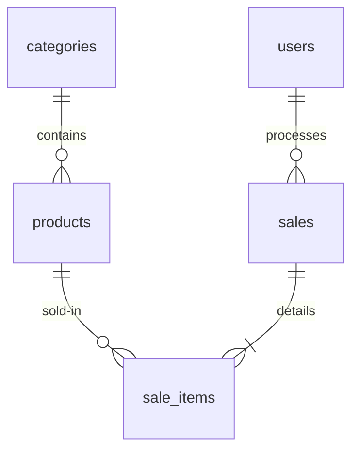

# Point of Sale (POS) System

A complete, lightweight, and modern **Point of Sale (POS) System** designed for small retail shops. Built from the ground up using **Laravel (PHP)**, **MySQL**, **Blade**, **Bootstrap 5**, and interactive **Vanilla JavaScript**.

---

## 🌟 Key Features

### 1. 🔐 Role-Based Authentication
- Secure Login, Registration, and Session management.
- Multi-role support: **Admin** and **Cashier** roles.
- Role-based middleware to guard administrative tools (managing categories, editing products, processing refunds, viewing analytics).

### 2. 📊 Performance Dashboard
- **KPI Metrics**: Real-time counters showing Total Sales Revenue, Today's Sales Revenue, Total Products, and Low-Stock Alert Count.
- **Order Log**: Displays the latest 5 completed transactions with cashier tracking.
- **Inventory Warnings**: Lists items that are low in stock (quantities <= warning threshold) for proactive restocking.

### 3. 🛍️ Interactive POS Terminal Screen
- **Quick Catalog**: Live search filtering by typing product name/SKU and clicking category pills.
- **Dynamic Shopping Cart**: Add/remove products and adjust quantities instantly using client-side JavaScript.
- **Stock Guardrail**: Real-time validation preventing checkout or additions exceeding available stock levels.
- **Checkout Calculations**: Calculates Subtotals, customizable Tax and Discount percentages, cash received, and change due.

### 4. 📦 Product & Category CRUD
- **Category Manager**: Single-page CRUD using interactive Bootstrap 5 modals to create/update categories.
- **Product Catalog Editor**: Form with file inputs for product images, retail pricing, cost tracking, stock values, and warning thresholds. Includes automatic unique SKU/barcode generation if left blank.

### 5. 🧾 Transactions & Printable Receipts
- Safe transactional checkouts using MySQL database transactions (`DB::transaction`).
- Generates unique invoice numbers.
- **Thermal Invoice Receipts**: Printable receipt view styled for standard 80mm thermal roll printers that automatically triggers browser print dialogs on load.
- Detailed invoice explorer logs featuring comprehensive order breakdowns.
- **Reversal Refund Actions**: Authorized Admins can reverse sales, automatically returning items back to inventory stock.

### 6. 📈 Reports & Spreadsheets Exports
- Financial statistics showing performance Today, This Week, and This Month.
- **Bestsellers Ranking**: Details top 10 items sold by popularity and revenue generation.
- **Stock Valuation Summary**: Calculates Total Stock cost, Total Stock Retail value, and Expected Profit margins.
- **Native CSV Exports**: High-speed, lightweight downloads for Sales Logs, Top-Selling items, and Current Stock metrics.

---

## 🛠️ Technologies Used
- **Backend**: PHP 8.x, Laravel (MVC Architecture, Eloquent ORM, DB Transactions, Migrations)
- **Frontend**: HTML5, Blade Templates, Bootstrap 5, Bootstrap Icons, Vanilla JavaScript
- **Database**: MySQL (relational constraints, cascading deletions, composite indexes)
- **Environment**: XAMPP (Local Apache & MySQL Server)

---

## 🚀 Installation & Local Setup

### Prerequisites
Make sure you have **PHP 8.x**, **Composer**, and **MySQL/XAMPP** active on your system.

### Step-by-Step Guide

1. **Clone the Repository**
   ```bash
   git clone https://github.com/reezmahanan/POS-System.git
   cd POS-System
   ```

2. **Install Composer Dependencies**
   ```bash
   composer install
   ```

3. **Configure Environment Variables**
   - Copy the example `.env` file:
     ```bash
     copy .env.example .env
     ```
   - Open `.env` and configure your database settings (database name, port, username, password). E.g.
     ```env
     DB_CONNECTION=mysql
     DB_HOST=127.0.0.1
     DB_PORT=3307  # Match your MySQL/XAMPP port (typically 3306 or 3307)
     DB_DATABASE=pos_system
     DB_USERNAME=root
     DB_PASSWORD=
     ```

4. **Prepare the Database**
   - Create a database named `pos_system` in your local MySQL Server (via phpMyAdmin or terminal).
   - Generate your unique application key:
     ```bash
     php artisan key:generate
     ```

5. **Run Migrations & Seeders**
   Rebuild tables and populate them with default roles, categories, and test products in one command:
   ```bash
   php artisan migrate:fresh --seed
   ```

6. **Create Public Storage Symbolic Link**
   Enable browser access to uploaded product images:
   ```bash
   php artisan storage:link
   ```

7. **Start the Local Server**
   ```bash
   php artisan serve
   ```
   Open your browser and navigate to `http://127.0.0.1:8000`.

---

## 🔑 Demo Access Credentials

The database seeder generates two default user accounts for testing:

| Role | Email | Password |
| :--- | :--- | :--- |
| **Admin Manager** | `admin@pos.com` | `admin123` |
| **Cashier clerk** | `cashier@pos.com` | `cashier123` |

---

## 📂 Database Relationships Structure



- `categories` has a one-to-many relationship with `products`.
- `users` (cashiers) has a one-to-many relationship with `sales`.
- `sales` has a one-to-many relationship with `sale_items`.
- `products` has a one-to-many relationship with `sale_items`.
